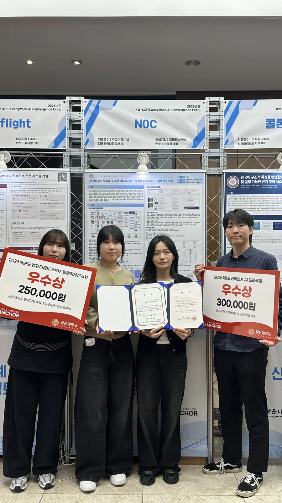
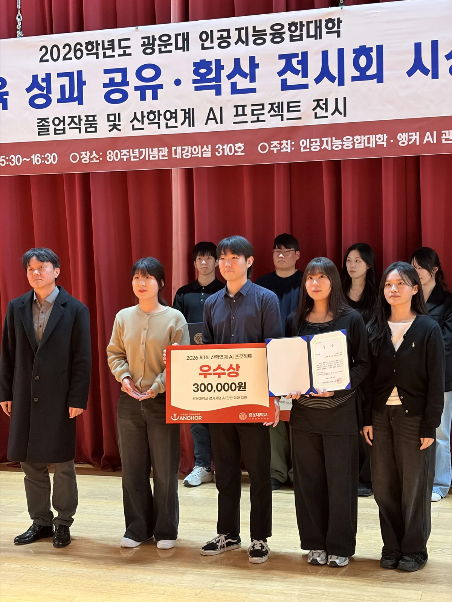
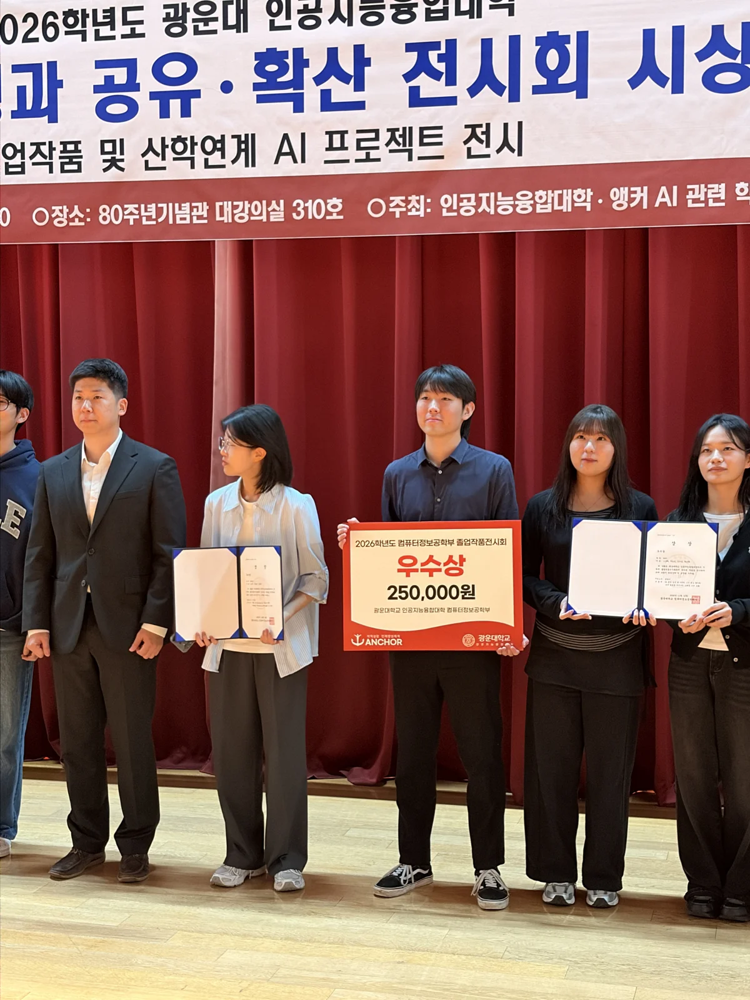

"NOC"팀이 2026학년도 광운대학교 인공지능융합대학 교육 성과 공유·확산 전시회(KW-ACE 2026)에서 **졸업작품**과 **산학연계 AI 프로젝트** 두 부문 모두 우수상을 수상했습니다.

- 졸업작품 부문: 2026학년도 컴퓨터정보공학부 졸업작품전시회 **우수상**
- 산학연계 부문: 2026 제1회 산학연계 AI 프로젝트 **우수상** (참여기업: 엠마헬스케어)
- 작품: "AI 생성 영상 및 CCTV 조작 영상 탐지와 근거 설명을 제공하는 신뢰성 분석 모델"
- 지도교수: 박철수 교수님

